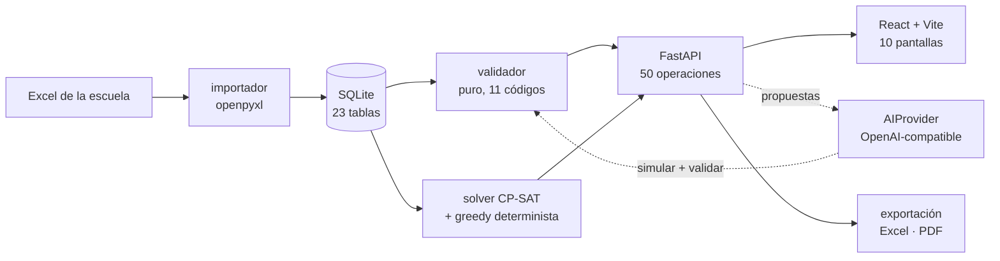

# Hourly

**Los horarios escolares dejan de ser una hoja de cálculo que nadie entiende.**

Hourly importa el Excel que tu escuela ya usa, encuentra todos los solapamientos, genera el
horario completo con un solver y explica —en castellano— por qué no se puede cuando no se puede.

---

## El problema

Armar horarios a mano no falla por falta de tiempo. Falla porque nadie puede sostener en la cabeza
la simultaneidad de 4 cursos, 6 docentes, 10 asignaturas y 120 sesiones repartidas en 5 días y 6
bloques. El Excel acepta el horario imposible y no dice nada.

Hourly sí dice algo. Y dice *por qué*.

## Cómo funciona

1. **Importá el Excel.** El mismo que ya usás, con sus hojas tal como están. Sin plantilla nueva.
2. **Auditá.** Cada fila con error o advertencia, ubicada por hoja, fila y columna, corregible en línea antes de confirmar.
3. **Generá.** Un solver CP-SAT arma el horario completo respetando disponibilidad, aptitudes, topes de carga y recursos.
4. **Entendé.** Si es imposible, el diagnóstico es aritmética, no una excusa: *"D4: demanda 28 sesiones, máximo 24"*.
5. **Decidí.** Cuando hay conflicto, la IA propone correcciones. Cada propuesta se simula sobre una copia y se pasa por el validador; si introduce un conflicto nuevo, se descarta sola.
6. **Probá el "¿y si…?".** "¿D3 no está esta semana?" — la grilla se reacomoda y ves qué cambió.

## Determinista primero, IA donde aporta

Esta es la diferencia con casi todo lo demás.

- El validador, el diagnóstico y el solver son **código puro**. Sin red, sin API key, sin rate limit. Funcionan sin internet.
- La IA entra **después**, para lo que el código no puede prever: explicar un conflicto en lenguaje claro, proponer una salida, interpretar "D2 no puede dar clase los martes".
- La IA nunca se cree. Toda propuesta se valida; toda regla interpretada vuelve editable y la confirma una persona.
- Si la IA no está disponible, la app sigue completa. Solo muestra "Asistente IA no disponible".

## Estado

| Fase | Qué entrega | |
|---|---|---|
| Modelo de datos | 23 tablas, invariantes duras en la DB | ✅ |
| Importador Excel | Lectura, preview con errores por fila, upsert idempotente | ✅ |
| Validador | 11 códigos de conflicto, escenarios, gravedad por contexto | ✅ |
| Solver CP-SAT | Generación, reparación greedy, penalización blanda | ✅ |
| API | 66 operaciones: catálogos, sesiones, generar, validar, propuestas, reglas, escenario, publicar, export | ✅ |
| Interfaz | 11 pantallas: importar en 4 pasos, grilla drag & drop, conflictos, reglas, escenario, publicación, configuración manual | ✅ |
| Demo | `demo.ps1` deja el estado del pitch: 118 de 120 sesiones y 2 sin colocar | ✅ |

Sin login, sin usuarios, sin multi-institución. Un solo administrador — es a propósito.

## Stack

| | |
|---|---|
| Backend | Python 3.12 · FastAPI · SQLAlchemy 2 · Alembic · Pydantic v2 |
| Solver | OR-Tools CP-SAT |
| IA | Cualquier API compatible con OpenAI (`AI_BASE_URL`), incluido Ollama local |
| DB | SQLite — un archivo, cero contenedores |
| Frontend | React · Vite · TypeScript · Tailwind · TanStack Query · dnd-kit |

## Correrlo

```bash
git clone https://github.com/JeffersonDevR/Hourly.git
cd Hourly
uv sync --directory api
corepack pnpm --dir web install
.\demo.ps1
```

Cinco comandos. `demo.ps1` migra la base, importa el Excel y siembra el estado del guion antes de
levantar la API (`:8000`) y la web (`:5173`).

- `-Check` arranca, verifica `/api/estado` y baja todo sin dejar puertos colgados.
- `-SinSemilla` arranca con la base tal como está (para el flujo de importar en vivo).
- `-Dev` levanta la API con `--reload`.

Requiere `uv` y Node 24+. **Ojo:** Node 25+ ya no trae `corepack`; ahí usá
`npx --yes pnpm@12.15.0 --dir web install`.

## Variables de entorno

Todas opcionales: sin ninguna, la app funciona completa y el asistente queda apagado.

| Variable | Default | Para qué |
|---|---|---|
| `DATABASE_URL` | `sqlite:///./hourly.db` | Cambiarla es volver a Postgres sin tocar código |
| `AI_BASE_URL` | — | Endpoint compatible con OpenAI (`…/v1`). Ollama local: `http://localhost:11434/v1` |
| `AI_MODEL` | — | Modelo a usar. Evitar modelos de razonamiento: emiten texto antes del JSON |
| `AI_API_KEY` | — | Sin las tres variables de IA, el proveedor es `NullProvider` |
| `SOLVER_TIMEOUT_S` | `20` | Tope de reloj de CP-SAT |

## Arquitectura en una imagen



La línea punteada es la única dependencia externa, y es opcional: si cae, todo lo demás sigue.

## Datos de demo

`data/Datos_prueba_Gnosoft.xlsx` no es un fixture decorativo: es el caso de prueba real.

4 cursos · 6 docentes · 10 asignaturas · 40 asignaciones · 16 recursos · **120 sesiones**.

Y trae un imposible a propósito: **D4 tiene demanda de 28 sesiones y un máximo de 24**. Con docentes
fijos el horario no existe; repartiendo Inglés entre D4 y D6, sí. Esa es la demo.

## Documentación

- [`docs/STATE.md`](docs/STATE.md) — **estado operativo**: qué falta, en qué orden, y cómo retomar en otra máquina
- [`docs/DOMAIN.md`](docs/DOMAIN.md) — entidades, invariantes y el mapeo del Excel
- [`docs/ARCHITECTURE.md`](docs/ARCHITECTURE.md) — API, solver, contrato de la IA
- [`docs/DECISIONS.md`](docs/DECISIONS.md) — las 22 decisiones y por qué
- [`docs/GAPS.md`](docs/GAPS.md) — los casos que faltan, sin maquillar
- [`design/stitch/README.md`](design/stitch/README.md) — el sistema de diseño vigente (dark), las 12 pantallas y sus defectos medidos
- [`docs/DEMO.md`](docs/DEMO.md) — el guion de 3 minutos, paso por paso
